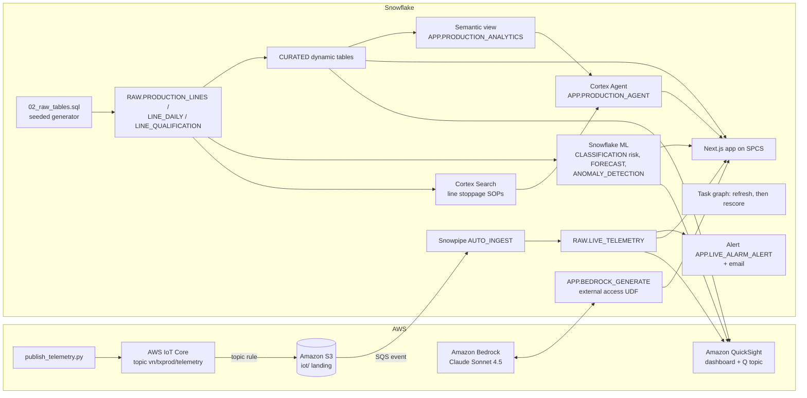

# Vietnam Garment Line Production - Cutting, Sewing and Packing Lines

Daily production planning for **28 garment production lines across 5 Vietnamese cities** (Nam Dinh, Thu Dau Mot, Da Nang, Hung Yen, Tan An) using Snowflake, optionally with AWS: from a live sewing-line controller alarm to a 7-day line stoppage risk score, an alarm email and an AI action memo for the head of production planning.

## Architecture

The build runs on **Snowflake** (Dynamic Tables, Snowflake ML, Cortex Search, Cortex Agent, Cortex AI_COMPLETE, SPCS) and, in the full build, **AWS** (IoT Core, S3, Bedrock Claude, QuickSight + Amazon Q). Line controller messages (throughput gap against the line target, WIP pieces waiting) land in `RAW.LIVE_TELEMETRY`. Dynamic tables curate 90 days of line-day history: pieces completed against the committed line plan, WIP queue hours per piece, line stoppages and line availability. Snowflake ML scores 7-day stoppage risk per line, forecasts network-wide plan attainment and flags throughput gap anomalies. A Cortex Agent answers questions with SOP citations, and an LLM drafts the production action memo.

Interactive diagrams (hover for object names): [Snowflake only](docs/architecture-snowflake.html) | [AWS + Snowflake](docs/architecture-aws.html). The app shows both on its Architecture & Data tab, the current build first. Regenerate them with `python3 docs/build_architecture.py aws snowflake`.



The Snowflake-only build drops the AWS subgraph: `APP.SIMULATE_TELEMETRY` writes to `RAW.LIVE_TELEMETRY`, and the app calls Cortex `AI_COMPLETE` instead of the Bedrock UDF.

## Snowflake Capabilities

| Capability | Implementation |
|-----------|---------------|
| Dynamic Tables | `CURATED.KPI_SUMMARY`, `PERFORMANCE_SUMMARY`, `CONSTRAINT_CAUSES` (stoppages by root cause), `TREND_ANALYSIS` from the RAW tables |
| Snowflake ML | CLASSIFICATION 7-day line stoppage risk (`ML.CONSTRAINT_RISK_SCORES`), 14-day plan-attainment FORECAST, throughput gap ANOMALY_DETECTION |
| Cortex Search | 18 synthetic line stoppage SOPs (one per line type and cause) in `SEARCH.PRODUCTION_SOP_SEARCH` |
| Semantic View | `APP.PRODUCTION_ANALYTICS` over garment lines, stoppage causes, daily plan attainment and risk |
| Cortex Agent | `APP.PRODUCTION_AGENT`: Cortex Analyst over the semantic view plus Cortex Search for SOP citations |
| Cortex AI | `AI_COMPLETE('claude-sonnet-4-5')` for grounded answers, and for the action memo in the Snowflake-only build |
| Alerts + Tasks | `APP.LIVE_ALARM_ALERT` logs ALARM readings and sends email; task graph `TASK_REFRESH_CURATED`, then `TASK_RESCORE_RISK` |
| Snowpark Container Services | Next.js app `APP.VN_TEXTILE_PRODUCTION_APP` with 6 tabs: Executive Cockpit, Predictive, Line Health, Live IoT, Ask AI, Architecture & Data |
| Snowpipe | `RAW.LIVE_TELEMETRY_PIPE` AUTO_INGEST from S3 (AWS build only) |

## AWS Services

Used only in the AWS + Snowflake build.

| Service | Role in Demo |
|---------|-------------|
| AWS IoT Core | Receives simulated sewing-line controller messages (throughput gap, WIP queue) published over MQTT. A topic rule writes each message to S3 |
| Amazon S3 | Landing bucket. An event notification goes to the Snowpipe SQS queue |
| Amazon Bedrock | Claude Sonnet 4.5 writes the action memo, called from Snowflake through an external-access UDF |
| Amazon QuickSight | DIRECT_QUERY executive dashboard over Snowflake (daily plan attainment, stoppages by line, stoppage risk) |
| Amazon Q | Natural-language questions over the QuickSight topic `vn-textile-production-topic` |
| AWS IAM | Least-privilege roles for S3, IoT and Bedrock |

## Personas

These personas are fictional.

| Persona | Role | Key Questions |
|---------|------|---------------|
| **Tran Thi Hong** | Head of Production Planning | "Which lines miss their committed line plan most often?" "Which stoppage causes cost us the most pieces?" |
| **Vo Quoc Bao** | Industrial Engineer (line balancing) | "Which lines are high stoppage risk this week, and which SOP applies?" |

## Data

All data is synthetic and seeded, so every rebuild reproduces it. Factories, lines, buyers and planners are fictional; the five cities are Vietnamese cities used as regions, and no figure describes a real factory or company.

| Table | Rows | Description |
|-------|------|-------------|
| RAW.PRODUCTION_LINES | 28 | Garment lines across 5 cities and 5 line types (Cutting, Knit Sewing, Woven Sewing, Quality Inspection, Finishing and Packing), with a qualified pieces-per-hour rate |
| RAW.LINE_DAILY | 2,520 | Daily line observations over 90 days: pieces released, committed and completed, WIP queue hours, stoppages, root cause, lost hours, PM, throughput gap and WIP queue |
| RAW.LINE_QUALIFICATION | 28 | Machines required to run each line's critical style with one machine down, machines with qualified operators and machines in operator qualification |
| SEARCH.PRODUCTION_DOCS | 18 | Synthetic line stoppage SOPs indexed for Cortex Search |
| RAW.LIVE_TELEMETRY | Grows during the demo | Live readings from IoT Core (AWS build) or `APP.SIMULATE_TELEMETRY` (Snowflake-only build) |
| ML.CONSTRAINT_RISK_SCORES | 28 | 7-day stoppage probability and risk band per line |

## Build Instructions

### Prerequisites
- Snowflake account with ACCOUNTADMIN access, and Cortex AI enabled (AI_COMPLETE, Search, Agent).
- An X-Small warehouse with auto-suspend at or below 120 s, and an existing SPCS compute pool.
- Python 3.11+, `snowflake-connector-python`, Node.js 22+, Docker and the `snow` CLI.
- App image: run `snow spcs image-registry login`, then build and push `vn-textile-production-app:v1` to the database's `APP.IMAGES` repository (see the header of `snowflake/07_deploy_app.sql`).
- AWS build only: `boto3`, AWS credentials for the target account (us-west-2) with Bedrock access, and QuickSight Enterprise.

### SPCS App
```
<DATABASE>.APP.VN_TEXTILE_PRODUCTION_APP
```

### Tests
```bash
python -m pytest aws snowflake quicksight
```

For a local run, put `SNOWFLAKE_ACCOUNT`, `SNOWFLAKE_USER`, `SNOWFLAKE_DATABASE`, `SNOWFLAKE_WAREHOUSE`, `SNOWFLAKE_AUTHENTICATOR=PROGRAMMATIC_ACCESS_TOKEN`, `SNOWFLAKE_TOKEN` and `DEMO_PLATFORM` in the environment, then run `npm --prefix app run build && npm --prefix app start`.

## Build Modes

Both modes share the same core. They differ in three places, and the app's `DEMO_PLATFORM` setting (in its SPCS spec) switches the memo provider and the Live IoT tab.

| Layer | Snowflake Only | Full AWS + Snowflake |
|---|---|---|
| Live telemetry | `CALL APP.SIMULATE_TELEMETRY(n)` inserts simulated readings into `RAW.LIVE_TELEMETRY`. This simulates a sewing-line controller feed; it is not Snowpipe Streaming | `aws/publish_telemetry.py` to AWS IoT Core, then S3, SQS and Snowpipe AUTO_INGEST |
| Action memo | Cortex `AI_COMPLETE('claude-sonnet-4-5')` | Amazon Bedrock Claude Sonnet 4.5 through `APP.BEDROCK_GENERATE` |
| BI and natural-language questions | The SPCS app is the dashboard; questions go to the Cortex Agent | Also a QuickSight dashboard and an Amazon Q topic |
| App setting | `DEMO_PLATFORM: snowflake` | `DEMO_PLATFORM: aws` |

### Snowflake Only

```bash
# 1. Core data and dynamic tables (guarded: new isolated database only)
python snowflake/run_core.py --database VIETNAM_TEXTILE_PRODUCTION_SNOWFLAKE --warehouse <XS_WAREHOUSE> --connection <CONNECTION> --apply
# 2. Native telemetry, ML, search, semantic view, agent, alert and task graph
python snowflake/run_intelligence.py --database VIETNAM_TEXTILE_PRODUCTION_SNOWFLAKE --platform snowflake --warehouse <XS_WAREHOUSE> --connection <CONNECTION> --alert-email you@example.com
# 3. App on SPCS with DEMO_PLATFORM=snowflake (push the image first)
python snowflake/run_intelligence.py --database VIETNAM_TEXTILE_PRODUCTION_SNOWFLAKE --platform snowflake --warehouse <XS_WAREHOUSE> --connection <CONNECTION> --alert-email you@example.com --files 07_deploy_app.sql --compute-pool <COMPUTE_POOL>
```

During the demo:
- Run `CALL APP.SIMULATE_TELEMETRY(20)` to add live readings. For a continuous feed, run `ALTER TASK APP.TASK_SIMULATE_TELEMETRY RESUME`, and `SUSPEND` it afterwards.
- Run `EXECUTE ALERT APP.LIVE_ALARM_ALERT` to raise the alarm email.
- Run `EXECUTE TASK APP.TASK_REFRESH_CURATED` to refresh the curated tables and rescore risk.

Afterwards, drop the database or run `ALTER SERVICE APP.VN_TEXTILE_PRODUCTION_APP SUSPEND`.

### Full AWS + Snowflake

```bash
# 1. Core data and dynamic tables (guarded: new isolated database only)
python snowflake/run_core.py --database VIETNAM_TEXTILE_PRODUCTION_AWS --warehouse <XS_WAREHOUSE> --connection <CONNECTION> --apply
# 2. AWS ingestion and Bedrock (dry run first, then --apply)
python aws/setup_aws.py --database VIETNAM_TEXTILE_PRODUCTION_AWS --account <AWS_ACCOUNT_ID> --connection <CONNECTION> --apply
# 3. ML, search, semantic view, agent, alert and task graph
python snowflake/run_intelligence.py --database VIETNAM_TEXTILE_PRODUCTION_AWS --platform aws --warehouse <XS_WAREHOUSE> --connection <CONNECTION> --alert-email you@example.com
# 4. App on SPCS with DEMO_PLATFORM=aws (push the image first)
python snowflake/run_intelligence.py --database VIETNAM_TEXTILE_PRODUCTION_AWS --platform aws --warehouse <XS_WAREHOUSE> --connection <CONNECTION> --alert-email you@example.com --files 07_deploy_app.sql --compute-pool <COMPUTE_POOL>
# 5. QuickSight dashboard and Q topic (needs an existing Snowflake data source)
python quicksight/build_dashboards.py --database VIETNAM_TEXTILE_PRODUCTION_AWS --account <AWS_ACCOUNT_ID> --principal-arn <QUICKSIGHT_USER_ARN> --data-source-arn <DATA_SOURCE_ARN> --prefix vn-textile-production --apply --update --with-topic
```

QuickSight objects must be shared with the QuickSight user who signs in (`--principal-arn`); otherwise the console shows nothing.

During the demo:
- Run `python aws/publish_telemetry.py --count 20` to send live readings.
- Run `EXECUTE ALERT APP.LIVE_ALARM_ALERT` to raise the alarm email.
- Run `EXECUTE TASK APP.TASK_REFRESH_CURATED` to refresh the curated tables and rescore risk.

Afterwards, `python aws/teardown_aws.py --database VIETNAM_TEXTILE_PRODUCTION_AWS --account <AWS_ACCOUNT_ID> --connection <CONNECTION> --apply` removes the AWS resources and the account-level Bedrock external-access and S3 storage integrations. It leaves the email integration `VN_TEXTILE_PRODUCTION_EMAIL_INT`, which the Snowflake-only build also uses.

## Business Impact

Snowflake customer outcomes in manufacturing:
- **ABB** (Snowflake customer, electrification and automation) uses Snowflake to unify incoming raw materials from suppliers, plant production capacity and sales orders. "With greater insights into available raw materials from vendors, factory capacity, and incoming sales orders, ABB has built a more resilient supply chain and factory floor and enabled us to better meet customer demand" -- [Snowflake Manufacturing Data Cloud press release](https://www.snowflake.com/en/news/press-releases/snowflake-launches-manufacturing-data-cloud-to-improve-supply-chain-performance-and-power-smart-manufacturing/)
- **Molex** (Snowflake customer, connector manufacturing) is "using the Snowflake Manufacturing Data Cloud to fuel their digital transformation journey, including sharing data securely across the organization and with external partners and generating manufacturing shop-floor and business KPIs" -- [Snowflake Manufacturing Data Cloud press release](https://www.snowflake.com/en/news/press-releases/snowflake-launches-manufacturing-data-cloud-to-improve-supply-chain-performance-and-power-smart-manufacturing/)

## Key Demo Numbers

These figures are synthetic and come from the seeded demo data. Forecast and anomaly figures can shift slightly with the build day.

- **28 garment lines**, 2,520 line-days over 90 days, across 5 Vietnamese cities and 5 line types
- **Plan attainment 97.7%**: 8,986,958 of 9,197,406 committed pieces completed (210,448 short); per-line attainment ranges from 91.9% to 99.1%, Knit Sewing is the lowest line type at 97.0% and Thu Dau Mot the lowest city at 97.1%
- **235 line stoppages** across 14 root causes; late fabric deliveries cost the most pieces (37,480 short), and SL-0006 (Knit Sewing, Tan An) and SL-0010 (Cutting, Thu Dau Mot) have the most stoppages (38 and 33)
- **Queue hours per piece 0.86 h** over 9,153,197 pieces released; line availability 98.7%
- **Backup machine coverage 59.3%**: 20 of 28 lines have fewer machines with qualified operators than their critical style needs
- **Stoppage-risk model** out-of-time holdout: precision 0.41, recall 0.20 at a 0.5 threshold, against a 0.40 base rate. Seven lines are high risk; the top line is SL-0006 (Knit Sewing, Tan An), at 94.5%
- **14-day plan-attainment forecast** averaging 95.7% with prediction intervals; **33 of 448** line-days flagged as throughput gap anomalies
- **18 SOPs** indexed for Cortex Search and cited by ID in agent answers

## License

Apache 2.0 — See [LICENSE](LICENSE) for details.

This is a personal demo project and is not an official Snowflake offering. It comes with no support or warranty. Customer outcomes cited are from publicly available Snowflake sources; they represent reported outcomes and are not guarantees of results.
